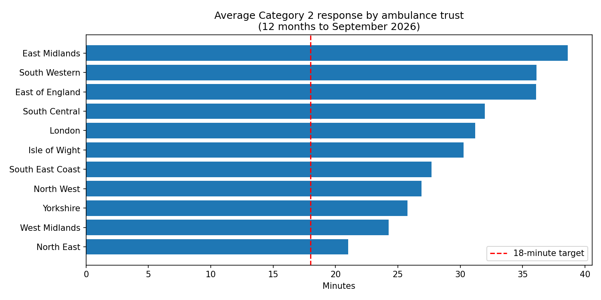
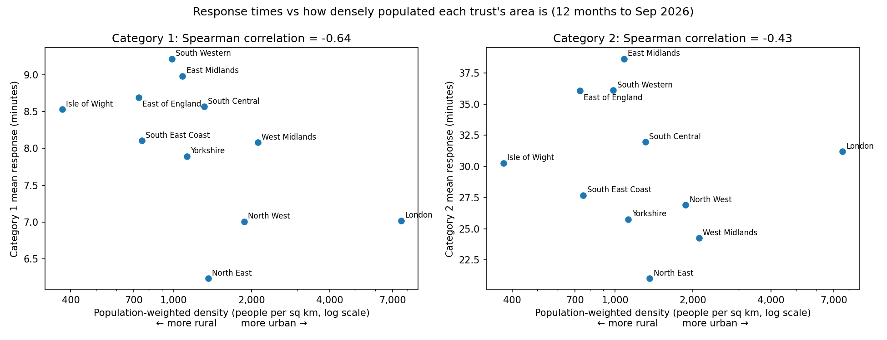

# Does where you live affect how fast an ambulance arrives?

An analysis of NHS ambulance response times across England's 11 ambulance trusts, and how they relate to deprivation, age, health and rurality.

**📊 Interactive dashboard:** [link coming soon](https://nhs-ambulance-response-time.streamlit.app/) · run it yourself with `streamlit run dashboard/app.py`



## Key findings

*Response times are for the 12 months to September 2026.*

1. **Category 2 response times are well above target everywhere.** Category 2 covers emergencies like strokes and heart attacks, and the target is a mean of 18 minutes. The England average peaked at 53 minutes in 2022 and was still around 30 minutes in 2026.
2. **There is a big gap between trusts.** The North East averages 21 minutes, while the East Midlands averages 38.6 minutes. That is almost twice as long.
3. **More deprived areas get *faster* responses, not slower ones.** This was the opposite of what I expected (Spearman correlation −0.68 between deprivation and Category 2 times).
4. **Rurality explains part of the gap, mainly for the most urgent calls.** Trusts whose populations live in less dense areas have slower Category 1 (life-threatening) responses (−0.64), but the link is weaker for Category 2 (−0.43).
5. **Busyness and older populations don't explain the gap.** Calls per person and % aged 65+ show almost no link with Category 2 times.
6. **London is an outlier.** It is by far the densest trust but is still slower than the England average for Category 2 (31.2 vs 30.5 minutes), which suggests other causes such as traffic or hospital handover delays.

**Conclusion:** geography matters for the most urgent calls, but much of the variation in Category 2 times is likely down to how each service and its local hospitals are run and resourced. That would need data on staffing and handover delays to test.

## The analysis

| Notebook | What it does |
|---|---|
| [`01_data_cleaning_and_first_look`](notebooks/01_data_cleaning_and_first_look.ipynb) | Loads and validates the AmbSYS data, confirms what each indicator code means by recalculating means from totals, fixes data quality issues and looks at national trends and trust differences |
| [`02_area_data_and_response_times`](notebooks/02_area_data_and_response_times.ipynb) | Builds a lookup from 153 council areas to 11 ambulance trusts, creates population-weighted trust-level measures (deprivation, age, mortality) and compares them with response times |
| [`03_rurality_and_response_times`](notebooks/03_rurality_and_response_times.ipynb) | Adds ONS population density, compares three measures of rurality, separates Category 1 from Category 2, tests sensitivity to London and compares rurality with deprivation |
| [`04_prepare_dashboard_data`](notebooks/04_prepare_dashboard_data.ipynb) | Prepares small data files for the dashboard and builds a map of the 11 trusts by merging council-area boundaries |

## The dashboard

[`dashboard/app.py`](dashboard/app.py) is an interactive Streamlit dashboard. Viewers can choose an ambulance service, the call category and a date range, and see:

- key numbers against the national target
- a map of England coloured by how each service compares with the England average
- monthly trends since 2018
- a ranking of the 11 services
- how response times relate to deprivation, age and rurality
- a table of the underlying numbers, which can be downloaded



## Methods worth noting

- **Weighted averages:** 12-month and trust-level response times are calculated as total waiting time ÷ total calls, not as an average of monthly averages, so busy months count for more.
- **Population weighting:** council-area measures are combined into trust figures weighted by population, so Birmingham counts for more than Rutland.
- **Population-weighted density:** the density of the area where the average person lives. This is a better guide to where 999 calls come from than simple density, which is skewed by empty moorland and farmland.
- **Data validation:** indicator meanings were confirmed by recalculating them, and organisations are matched by official code rather than by name, because one trust appears under two names in the source data.
- **Spearman correlation:** this compares rankings, so it is less affected by one unusual trust.

## Limitations

- **Only 11 ambulance trusts**, so the correlations are clues, not proof.
- **Correlation is not causation.** Staffing, hospital handover delays and local operations are not in this data.
- **Trust averages hide local variation.** Large trusts include both cities and countryside.
- **The council-area-to-trust lookup is approximate** at a few borders where neighbouring trusts serve small areas.
- **Deprivation uses IMD 2019**, the version available in the Fingertips data at the time.

## Data sources

All data is public and aggregated. No patient-level or identifiable information is used.

| Data | Publisher | Used for |
|---|---|---|
| [Ambulance Quality Indicators (AmbSYS)](https://www.england.nhs.uk/statistics/statistical-work-areas/ambulance-quality-indicators/), Aug 2017 – Sep 2026 | NHS England | Response times and call volumes by trust |
| [Local Authority Health Profiles](https://fingertips.phe.org.uk/profile/health-profiles), Counties & UAs (from Apr 2023) | Office for Health Improvement and Disparities (OHID) | Deprivation, % aged 65+, under-75 mortality, population |
| [Estimates of the population for the UK, England, Wales, Scotland and Northern Ireland](https://www.ons.gov.uk/peoplepopulationandcommunity/populationandmigration/populationestimates/datasets/populationestimatesforukenglandandwalesscotlandandnorthernireland), mid-2025, table MYE5 | Office for National Statistics (ONS) | Land area and population density |
| [Counties and Unitary Authorities (December 2024) Boundaries UK BUC](https://geoportal.statistics.gov.uk/) | ONS Open Geography Portal | Map outlines (contains OS data © Crown copyright and database right) |

## How to run it

1. Clone this repository and install the requirements:
   ```bash
   pip install -r requirements.txt
   ```
2. Download the data files from the links above into `data/raw/`:
   - the AmbSYS CSV (any file name starting `AmbSYS`)
   - `indicators-CountiesUAsfromApr2023_data.csv` from Fingertips ("Data for Upper tier local authorities (post 4/23)")
   - the ONS mid-year estimates Excel file (e.g. `mye25tablesuk.xlsx`)
   - the ONS Counties and Unitary Authorities (December 2024) BUC boundaries, as GeoJSON
3. Run the notebooks in order: 01, 02, 03, 04. Each saves files into `data/processed/` for the next one to use, and charts into `outputs/figures/`. Notebook 04 saves the dashboard's data into `dashboard/data/`.
4. Start the dashboard from the project folder:
   ```bash
   streamlit run dashboard/app.py
   ```

The dashboard's data files are included in this repository, so step 4 works without running the notebooks.

## Project structure

```
nhs-ambulance-response-analysis/
├── data/
│   ├── raw/            original downloads (not edited)
│   └── processed/      clean files created by the notebooks
├── notebooks/          analysis, run in order
├── outputs/figures/    saved charts
├── dashboard/
│   ├── app.py          Streamlit dashboard
│   ├── data/           small data files the dashboard reads
│   ├── assets/         original illustrations used in the dashboard
│   └── requirements.txt
├── .streamlit/
│   └── config.toml     dashboard colours and settings
├── requirements.txt
└── README.md
```

## Possible next steps

- Add hospital handover delay data to test whether it explains the remaining differences, especially in London.
- Compare trusts over time to see whether the gap is growing or shrinking.
- Rebuild the dashboard in Power BI, which many NHS teams use.
